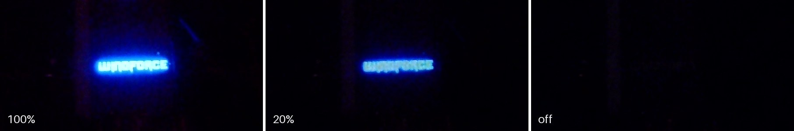
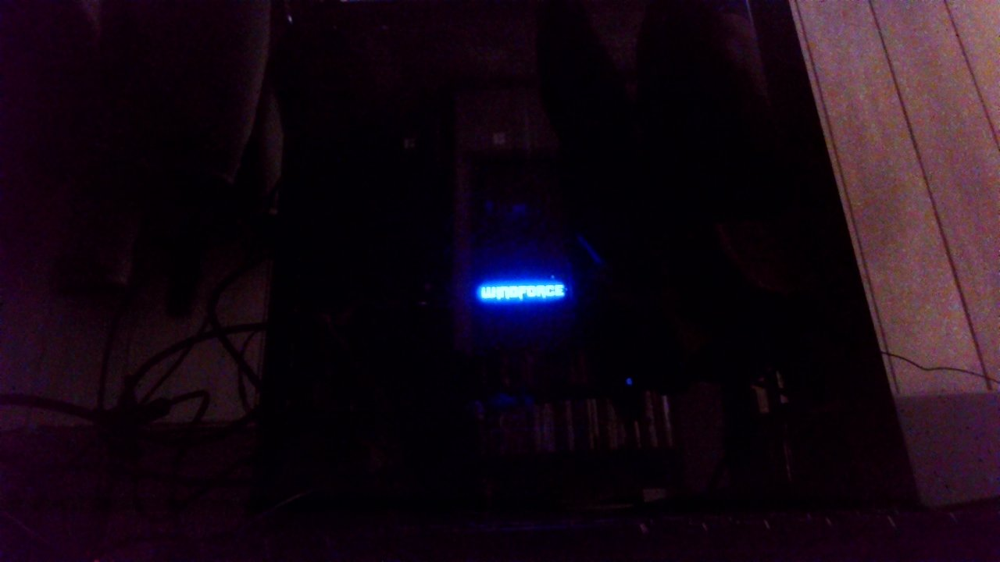

# gtx-970-light-control

Brightness, effects and night dimming for the WINDFORCE logo light on a
Gigabyte GTX 970 G1 Gaming, from Linux. Worked out and built by an AI agent
that could see the card through a webcam.



## How this came about

The brief, typed to Claude Code on the machine itself:

> this machine has a gigabyte windforce gtx 970 that has an rgb light on it.
> when I first got it, I was able to control that light. At some point, that
> option was taken away. See if you can figure out how to control it again. I
> set up a web cam pointed at it, so you should be able to see whether it's
> changed or not.

What the agent did with it, in order:

1. **Looked at the machine.** A GTX 970 with a Gigabyte subsystem ID, running
   the open-source nouveau driver, with 21 I2C buses and one webcam. The first
   frame from the webcam showed the logo, lit blue.

   

2. **Chased the obvious idea, and dropped it.** Newer Gigabyte cards have an RGB
   controller chip on an I2C bus, and tools such as OpenRGB talk to it. Searching
   turned up no such thing for this card. It turned up something better: reviews
   from the card's era saying the logo was controlled by the LED Visualizer in
   NVIDIA's GeForce Experience, and that it was blue only.
3. **Followed what that implied.** If NVIDIA's own software drove the light, the
   card must use NVIDIA's reference logo-LED output, the one behind the GEFORCE
   GTX logo on reference cards. nouveau has a driver for that output. One `ls`
   later: `/sys/class/leds/nvidia-logo`, sitting there the whole time, writable
   only by root and reset to full brightness on every boot.
4. **Proved it with the camera.** Wrote `0` to the LED; lit pixels in the logo
   region went from 1183 to 0. Then 16, 64, 128 and 255 gave 388, 611, 799 and
   1140.
5. **Checked the premise.** The card's firmware names it `GV-N970G1 GAMING-4GD`.
   That model's logo is a single blue LED, so the "RGB" in the brief was a
   misremembering, and the option that "was taken away" was NVIDIA dropping the
   LED Visualizer.
6. **Built the tool, and kept watching.** Each effect was checked by sampling
   the webcam over a few seconds. This is the logo's brightness over time, one
   character per video frame:

   ```
   breathe    :::--------=======++++++*******#####%%%%%%%@@@@@@@@@@@%%%%%#####******++++++=+======-------:-::::::.            ::::
   blink      -%@@@@@@@@@@@@@@               #@@@@@@@@@@@@@@-              #@@@@@@@@@@@@@@*              *@@@@@@@@@@@@@@%
   ```

   The camera caught what reading the settings back could not: an early load
   indicator that ran without error and never changed the logo, and a
   background service that overwrote the breathing effect with one last frame
   of its own after another mode had taken over.
7. **Added night dimming when asked for it.** The request was for something
   like a screen dimmer, so the schedule scales whatever mode is showing
   instead of replacing it: a breathing logo keeps breathing, just fainter.
   The machine's clock turned out to be on UTC, which would have put every
   time hours off, so a schedule carries its own timezone. On the card, a
   six-minute test fade stepped 238, 189, 136, 91, 56, 29, one step a minute.
8. **Reworked the CPU indicator.** The kernel's built-in one flashes, and on a
   desk it read as a strobe. At the owner's suggestion it became a heartbeat,
   like an athlete's: slow and soft at rest, fast and hard under load. Calm,
   then flat out:

   ```
   calm       **********************%%%@@%%##%##%%#%##**********************#%@@@@#####%##%###**********************#%#@@%%%##
   flat out   -*@@**+*##**---------*@@%****#*---------*@@%++**##*--------:#@@**+*##*+---------*@@#***##*+-:-------*@@*++**#*+-
   ```

## Using it

```
gpu-logo off                 # dark
gpu-logo on                  # full brightness
gpu-logo set 30              # fixed brightness, percent
gpu-logo breathe             # fade in and out (--period SEC, --min/--max PERCENT)
gpu-logo blink               # flash (--on MS, --off MS, --level PERCENT)
gpu-logo cpu                 # heartbeat that follows CPU load (see below)
gpu-logo disk                # flicker on disk activity
gpu-logo status
```

The mode you pick is remembered and re-applied at boot. Add `--no-save` before
the command to try something without remembering it.

### Night dimming

```
gpu-logo schedule --dim 23:30-02:00 --brighten 08:30-09:00 --level 10 --tz America/New_York
gpu-logo schedule            # show the schedule and what it is doing right now
gpu-logo schedule --off      # remove it
```

That example starts dimming at 23:30, reaches 10% at 02:00, stays there until
08:30, and is back to normal by 09:00. It scales whatever mode is showing
rather than replacing it.

| Option | Meaning |
| --- | --- |
| `--dim` | `START-END` fades down gradually between the two times; a single time switches at once. 24-hour, and the span may cross midnight. |
| `--brighten` | The same, for returning to normal. |
| `--level` | Brightness while dimmed, as a percent of normal. `0` turns the logo off. Default 10. |
| `--tz` | Timezone the times are in. Defaults to the system clock's, which on a server is often UTC; `gpu-logo schedule` prints the time it is working from. |

### The CPU heartbeat

`gpu-logo cpu` beats like a heart: a strong pulse, a weaker one, a rest. The
logo keeps a faint glow between beats, so it swells rather than flashes.

| | Calm | Flat out |
| --- | --- | --- |
| Pace | 46 beats a minute | 92 beats a minute |
| Strength | a gentle swell, to about 15% | full brightness |

It follows total CPU use across every logical core, sampled every two seconds
and smoothed over about ten, so a brief spike barely registers and sustained
work brings the pace up gradually. Pace and strength move in nine steps, and
each change waits for the rest between beats, so the rhythm never jumps.

The numbers that set the feel are named constants at the top of `gpu-logo`.

## Setting it up

Hand it to your agent: [AGENTS.md](AGENTS.md) tells it how to check whether your
card qualifies, install, and confirm with you that the light responds. No
webcam is needed; it will ask you what the light is doing.

By hand: `sudo ./install.sh`, and `sudo ./uninstall.sh` to remove everything.
It needs the nouveau driver, systemd, Python 3.10 or newer, and membership of
the `plugdev` group.

## How it works

Nothing here talks to the card directly; it all goes through the kernel LED
that nouveau provides.

| Piece | Role |
| --- | --- |
| `gpu-logo` | CLI. Fixed levels write `brightness`; effects hand a pattern to a kernel LED trigger, which draws it. Nothing of this tool's stays running, except while the cpu mode is showing. |
| `udev/70-gpu-logo-led.rules` | Runs `gpu-logo udev-hook` as root when the LED appears or changes: gives group `plugdev` write access to the LED's attributes, and on first appearance re-applies the saved mode. |
| `systemd/gpu-logo-schedule.timer` | Runs `gpu-logo tick` once a minute. It does nothing unless a schedule is set and the brightness it calls for has changed. |
| `systemd/gpu-logo-cpu.path`, `.service` | Start the heartbeat's load sampler when the saved state changes. It exits at once unless the cpu mode is showing, and exits when another mode replaces it. |
| `modules-load.d/gpu-logo.conf` | Loads the trigger modules at boot. |
| `/var/lib/gpu-logo/` | The saved mode, the schedule, and a note of what was last applied. Group-writable, so everything read from it is validated strictly before root acts on it. |
| `tools/observe.py` | Optional. Measures the logo through a webcam, to confirm a command changed the real light. |
| `tests/` | Schedule arithmetic, input validation, pattern shapes and mode logic against a fake LED directory: `python3 -m unittest discover tests` |

## What was verified

On Ubuntu 24.04 (kernel 6.8, nouveau), by counting lit pixels in the logo
region of the webcam image:

- off, and brightness 16 / 64 / 128 / 255, each produced a distinct level
- breathe, blink and disk each showed the expected pattern over time, and
  breathe kept its 4-second period
- the heartbeat at calm, half and full effort, and its pace following real
  load
- modes came out fainter under a schedule, and the timer stepped a fade down
  minute by minute
- switching modes quickly, including into and out of the heartbeat
- the boot-time restore, by replaying the device's udev `add` event
- uninstall followed by install

Not tested: an actual reboot, and suspend/resume.

## Limits

- Colour cannot change: the LED is blue.
- nouveau only. NVIDIA's proprietary driver does not create
  `/sys/class/leds/nvidia-logo`. It has its own `GPULogoBrightness` setting in
  `nvidia-settings`, which is untested with this card.
- Other cards: anything nouveau exposes as `nvidia-logo` should work, but only
  this model (PCI `10de:13c2`, subsystem `1458:367a`) has been tried.
- `tools/observe.py` has the logo's position in the webcam frame hard-coded
  (`ROI`); re-tune it for your own camera.

## License

MIT; see [LICENSE](LICENSE).
